# UCTS · UEFI 组件测试套件

**UEFI Component Test Suite** —— 直接在 UEFI 固件里运行的整机诊断工具。插上 U 盘或挂一张
ISO，开机就能查看平台信息、跑内存图案检测、读硬盘 SMART、做硬盘擦除、跑 CPU 指令自检与
多核压力测试，并按 `F2` 把结果导出成 HTML 报告。键盘和鼠标（含 BMC 远程 KVM 的绝对指针）
都能操作，界面中英双语，`F4` 随时切换。

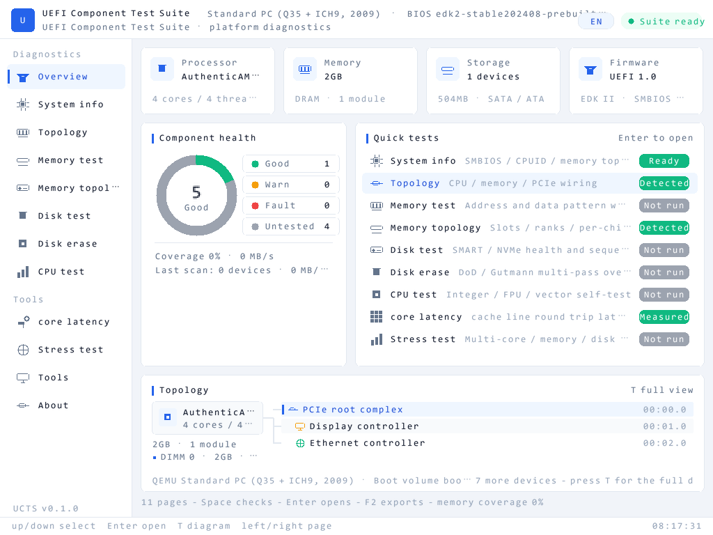

- 当前版本：**0.1.0**
- 运行环境：UEFI 2.x（x86_64），标准协议，无私有依赖；真机与 QEMU/OVMF 均可
- 发行包：`UCTS-<版本>-BOOTX64.EFI`、`UCTS-<版本>.iso`、源码压缩包（见 [Releases](../../releases)）

---

## 1. 功能一览

套件共 **11 个页面**，左侧栏切换，`1`–`9`、`0` 也能直接跳转。

| 页面 | 能做什么 |
| --- | --- |
| **概览** | 组件健康度圆环、快速检测入口（每项标注就绪/已识别/已运行）、底部系统连接图卡片 |
| **系统信息** | SMBIOS 类型 0/1/2/4/16/17、CPUID 叶子、指令集特性矩阵、缓存与频率、内存条清单 |
| **系统拓扑** | CPU / 内存 / PCIe 连接图，按层次缩进列出每个功能（`bus:dev.fn`、协商链路 `Gen3 x1`、挂载的盘与网卡），选中项显示配置空间详情 |
| **内存检测** | 10 种地址/数据图案的写入回读比对，覆盖率、带宽、错误计数，错误折算到 DIMM 插槽；同时给**整体进度**与**当前图案覆盖** |
| **内存拓扑** | 插槽摘要、DIMM 健康圆环、socket / 通道视图，`Enter` 打开**颗粒视图**（正反面 PCB、D1…Dn、RCD/PMIC/SPD、报错颗粒高亮、位到颗粒映射） |
| **硬盘检测** | ATA / NVMe 枚举、Identify + SMART、单盘与全盘顺序只读扫描、速度曲线 |
| **硬盘擦除** | 快速清零 / DoD 5220.22-M / Gutmann 精简 / 随机覆写，写后回读校验，二次确认 |
| **CPU 检测** | ALU / BitOps / SSE2 / AVX / RDRAND / 缓存带宽 / TSC 共 7 项自检 + 吞吐测量 |
| **核间延迟** | 逐对测量处理器间的缓存行往返延迟（单程纳秒），热力图按插槽分块，给出同核双线程 / 同插槽 / 跨插槽中位与插槽 × 插槽矩阵 |
| **压力测试** | CPU（按逻辑处理器勾选，最多 256 条）、内存（按 DIMM 勾选）、硬盘（随机 LBA 只读）三组可分别开关，可设时长，实时显示速率、流量、循环、异常与剩余时间 |
| **工具集** | 扫描启动卷 `\EFI\TOOLS`、`\EFI\BOOT` 下的外部 EFI 工具并直接启动；内置"重读平台信息 / 导出报告 / 刷新硬盘健康 / 跳转并开跑"等快捷动作 |
| **关于** | 版本、运行平台、开发信息、已集成能力清单、按键约定、指针与会话摘要 |

---

## 2. 页面细节

### 2.1 概览

一屏看清机器状态：处理器 / 内存 / 存储 / 固件四张卡片、组件健康度圆环、快速检测列表，
底部直接画出 CPU、内存条与 PCIe 连接图（`T` 打开完整视图）。


### 2.2 系统信息

SMBIOS 与 CPUID 的原始字段，加上指令集特性矩阵和内存条清单。`F5` 重新采集，`F2` 直接出报告。

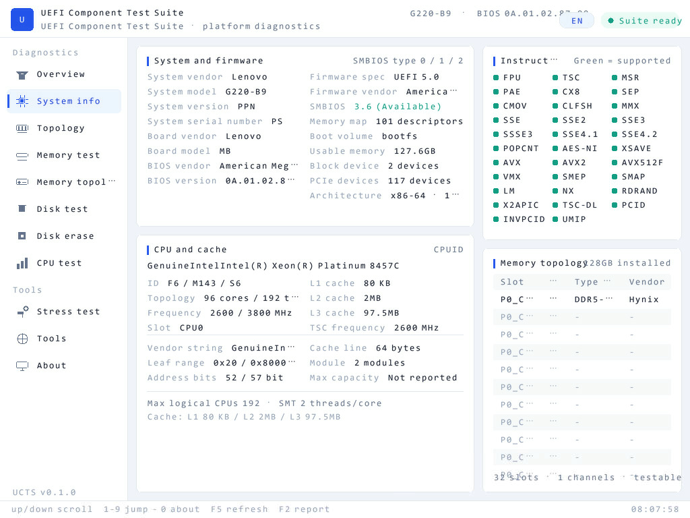

### 2.3 系统拓扑

从固件已绑定的 PCI I/O 实例出发，把处理器、内存、根桥、桥和端点画成一棵缩进的树，
每行带 `bus:dev.fn`、协商链路速率/宽度，以及该控制器下挂的块设备或网卡。
`↑↓` 选设备，下方显示配置空间详情；`Enter` 跳到它挂的硬盘。

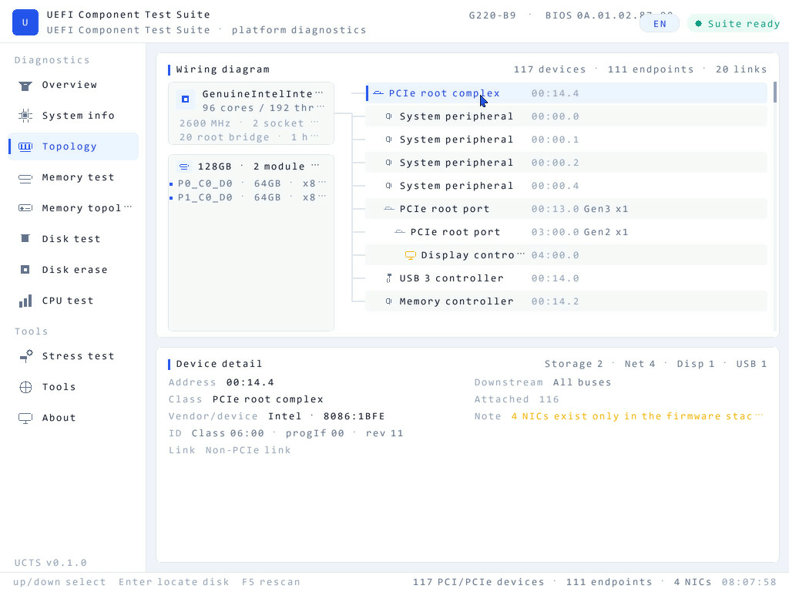

### 2.4 内存检测

10 种图案（全 0 / 全 1 / 棋盘 55/AA 与 AA/55 / 地址位 / 地址异或全 1 / 地址异或 55AA /
伪随机 LFSR / 走动 1 / 走动 0）。`空格` 勾选图案，`F5` 开始，`F6` 停止，`F7` 只看图案页，
`F8` 只看覆盖率，`T` 直接跳到颗粒视图。

运行中同时给出两个数字：**整体进度**（所有已启用图案走完的比例）和**当前图案覆盖**
（这一个图案已走完的字节数），不会出现"第一个图案还没跑完就 99%"。

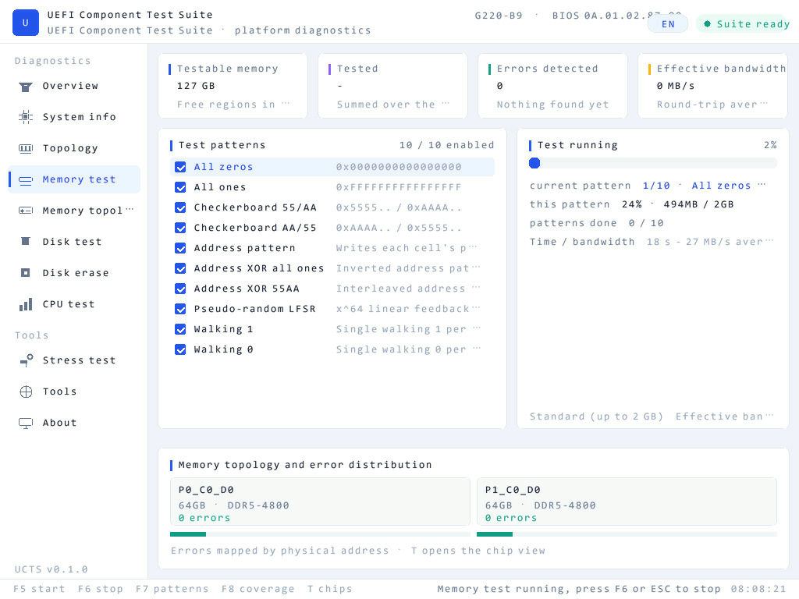

### 2.5 内存拓扑与颗粒视图

插槽摘要（装机/启用/空槽）、DIMM 健康圆环、socket × 通道的卡片视图；滚动条可以点、可以拖，
选区跟着滚动。`Enter` 打开颗粒视图：正面 rank0、背面 rank 1，`B` 切换正/背面，
D1…Dn 颗粒、RCD/PMIC/SPD、丝印与电压、以及 `D1 bit0-7 …` 的位到颗粒映射表都在一屏里。

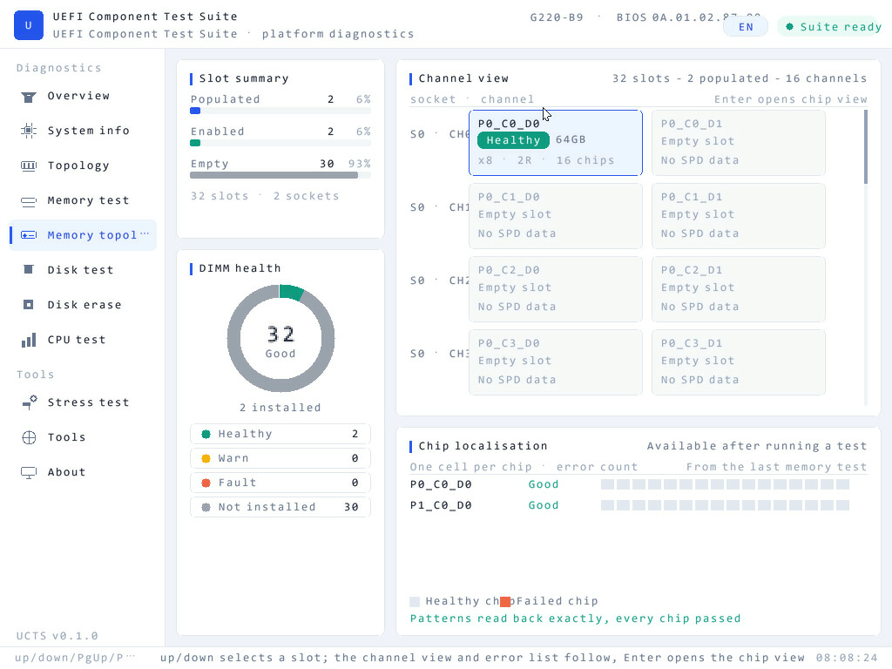

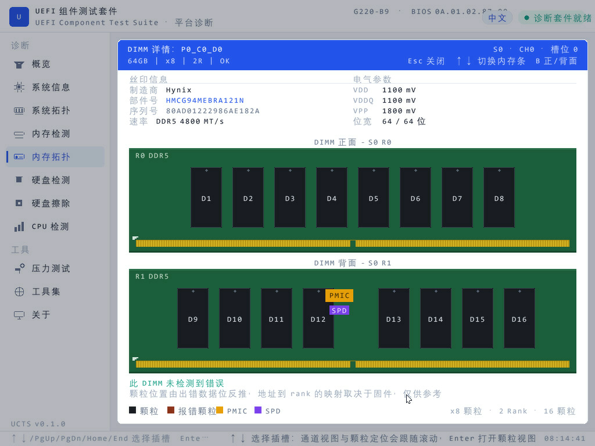

### 2.6 硬盘检测

ATA 与 NVMe 统一成一张列表：容量、接口、健康结论。右侧详情包含型号、序列号、固件版本、
NVMe 温度与通电小时、累计写入量，以及设备路径。`F5` 扫描当前盘，`F9` 扫描全部，`Enter` 刷新健康。

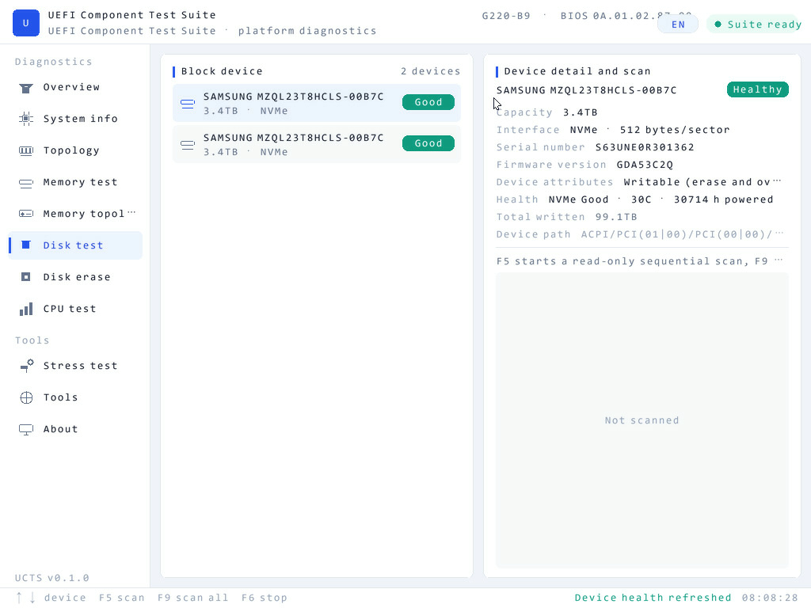

硬盘擦除页提供 4 种算法、写后回读校验，擦除前必须键入 `ERASE` 二次确认，
当前启动盘会被标记并在确认框里额外告警。

### 2.7 CPU 检测

7 项自检逐项给结论，右侧是吞吐面板（整数 MOPS、浮点 MFLOPS、拷贝 MB/s、TSC 频率）。
`空格` 勾选，`F5` 运行，`F7` 全选，`F8` 只留核心项。

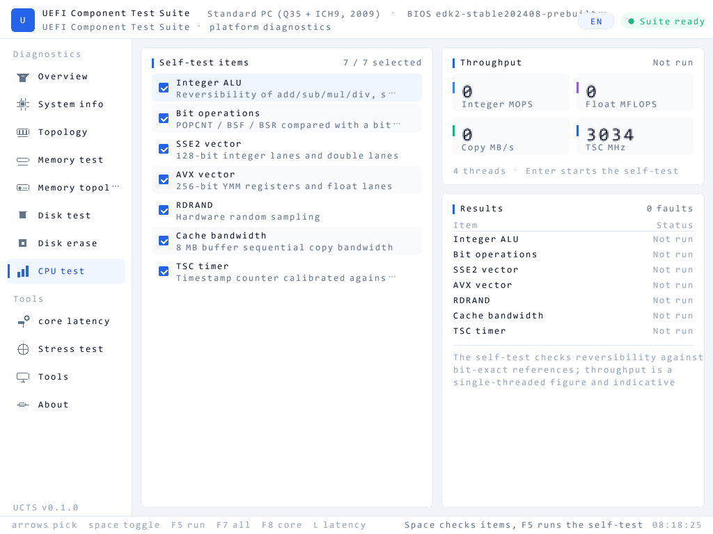

### 2.8 核间延迟

逐对测量处理器之间的缓存行往返延迟：一对逻辑处理器在同一缓存行上乒乓一个计数器，
只有计时核心在两端读 TSC，单程 = 往返 / 2，每对取 96 轮（前 16 轮预热）的中位数。

`F5` 开始或重测，`Z` 放大矩阵并显示纳秒数值，方向键选择处理器对，`F6`/`Esc` 中止。
多插槽机器按插槽分块（`P0`/`P1`… 之间有分隔线），右侧给出同核双线程 / 同插槽跨核 / 跨插槽的
中位延迟、最小与最大、跨插槽与同插槽的倍比，以及插槽 × 插槽的中位矩阵，跨片互连是否对称一眼可见。

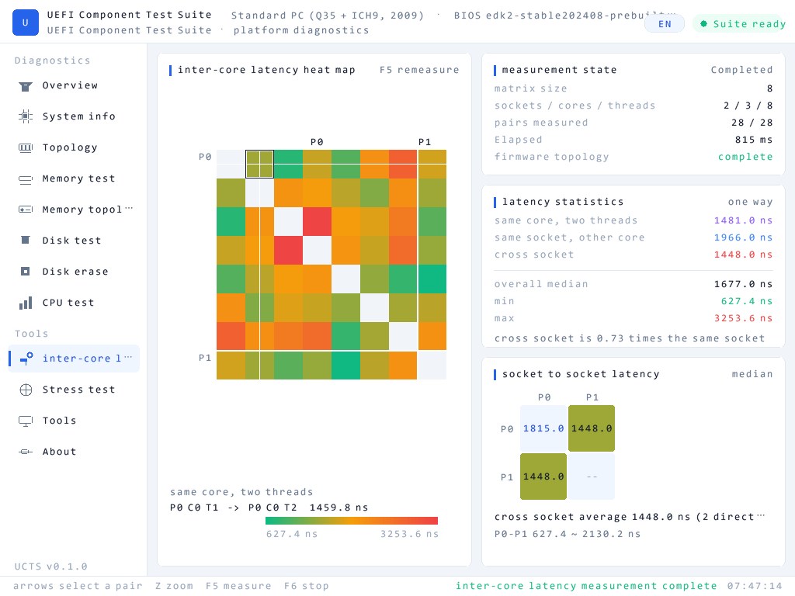

双路机器的实测（2 插槽 × 48 核 × 2 线程 = 192 逻辑处理器，18336 对，约 1.9 秒）：
对角线是同核双线程（约 21 ns），两个方块是同插槽（约 64 ns），跨插槽区域约 50 ns，
竖条纹表示某些处理器自身的延迟明显偏离整体，也是这类热力图最有用的地方。

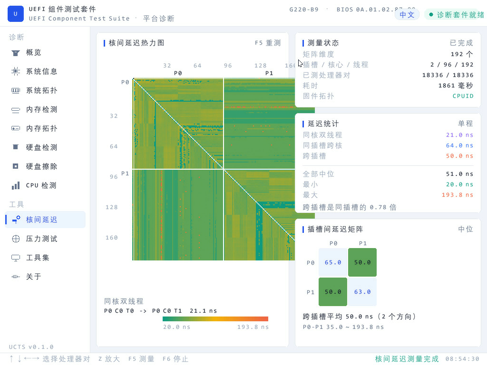

插槽与核心的划分优先用 CPUID 拓扑叶子（`0x1F` / `0x0B`，退回 `0x04`）解码 APIC ID，
固件的 `EFI_CPU_PHYSICAL_LOCATION` 作为退路——部分服务器固件不填这个字段，会把双路机器认成单路。

### 2.9 压力测试

三个组件分别开关，目标列表逐条勾选：CPU 按逻辑处理器（双路机器按 `S0 · 逻辑处理器 n` 分组，
最多 256 条）、内存按已安装 DIMM、硬盘按块设备（只做随机 LBA 只读）。`-`/`=` 调时长，
`Tab` 换分组，`Enter` 开始并键入 `GO` 二次确认，`Esc`/`F6` 中止。

运行中实时显示选中数量、已运行/剩余时间、每组件速率与流量、循环次数与异常日志。

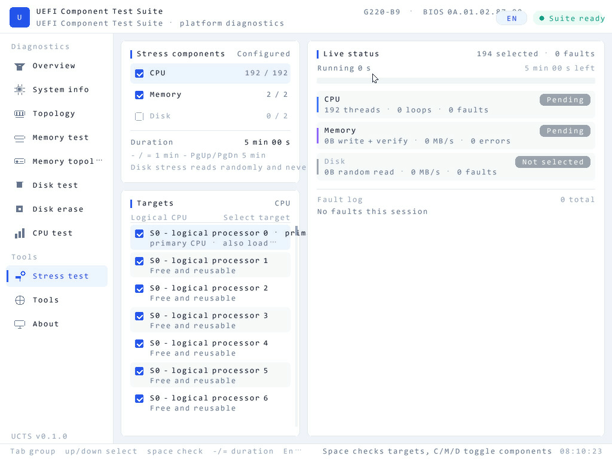

### 2.10 工具集

启动卷 `\EFI\TOOLS`、`\EFI\BOOT` 下的 `.efi` 会被自动列出（下图中列出的是系统 ESP 上已有的
`grubx64.efi`、`mmx64.efi`、`fbx64.efi`），选中即 `LoadImage` + `StartImage` 运行，退出后回到套件。
内置动作可以一键重读平台信息、导出报告、刷新硬盘健康，或者跳到某个页面直接开跑。

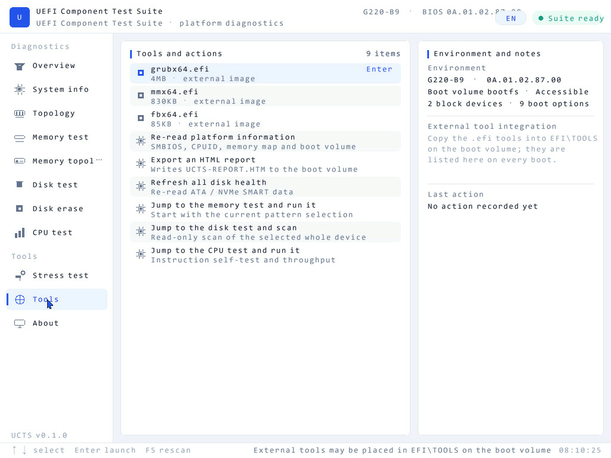

### 2.11 关于

版本、运行平台、开发信息、已集成能力清单、按键约定和本次会话摘要（含指针协议、移动/点击次数）。

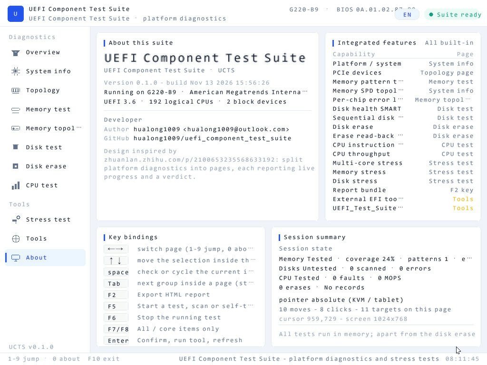

---

## 3. 界面与语言

侧栏底部始终显示当前版本（如 `UCTS v0.1.0`）；`F4` 在 English / 中文之间切换，
选择写入 NVRAM（变量 `UctsLang`），重启后保持，默认英文。

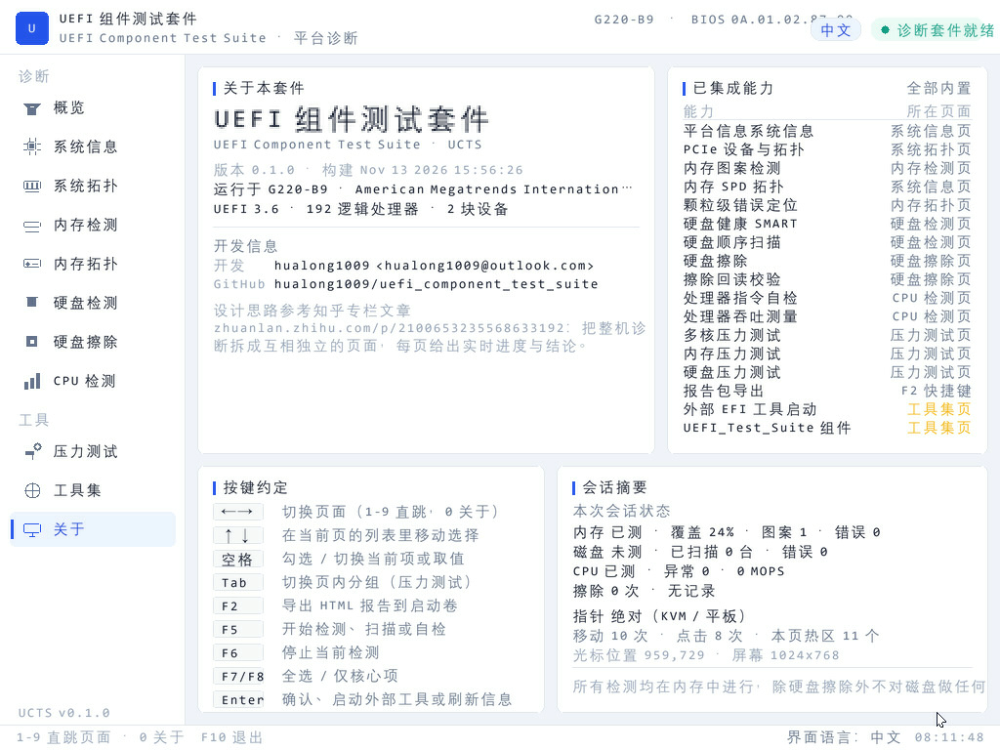

界面按 1024×768 设计，横向自适应；浅色仪表盘风格，所有文字由内置点阵字库渲染（无外部依赖）。

---

## 4. 键盘与鼠标

| 按键 | 含义 |
| --- | --- |
| `← →` | 上一页 / 下一页（只做换页） |
| `1`–`9`、`0` | 直接跳页，`0` 是"关于" |
| `↑ ↓` | 列表里上一行 / 下一行，必要时自动滚动 |
| `PgUp` / `PgDn` | 翻一页行；压力测试页调时长 ±5 分钟 |
| `Home` / `End` | 首行 / 末行 |
| `空格` | 勾选 / 循环切换当前项（图案、自检项、压测目标、擦除算法） |
| `Tab` | 压力测试页切换分组 |
| `Enter` | 确认、打开、启动（等同鼠标双击） |
| `F2` | 导出诊断报告 |
| `F4` | 中英文切换 |
| `F5` | 开始检测 / 扫描 / 自检 |
| `F6` | 停止当前检测 |
| `F7` / `F8` | 全选 / 仅核心项 |
| `Z` | 核间延迟页放大 / 还原矩阵（放大后显示纳秒数值） |
| `L` | CPU 检测页跳转到核间延迟页 |
| `Esc` | 返回 / 取消 / 中止 |
| `F10` | 退出套件并重启 |

鼠标（绝对指针 + 相对指针同时支持，BMC 远程 KVM 请把"鼠标模式"选成**绝对鼠标模式**）：

| 操作 | 效果 |
| --- | --- |
| 移动 | 光标跟随，悬停可点击区域时变蓝 |
| 单击侧栏 | 切换页面 |
| 单击列表行 | 选中该行 |
| 单击复选框（行首 30 像素） | 直接勾选/取消 |
| 再次单击同一行 | 等同 `Enter`：打开、启动、切换 |
| 单击对话框选项 / 遮罩外 | 执行该选项 / 取消 |
| 滚轮、拖动滚动条 | 列表与长页面滚动（BMC 平板不报滚轮时用 `PgUp`/`PgDn`） |

---

## 5. 诊断报告

`F2` 弹出菜单，可导出单个文件或整套 5 个文件，写入启动卷根目录并逐个回读校验：

| 文件 | 内容 |
| --- | --- |
| `UCTS-REPORT.HTM` | 完整报告：平台 / 处理器 / 核间延迟 / 内存拓扑 / 内存检测 / 存储 / CPU 检测 / 压力测试 / 擦除记录 |
| `UCTS-SYSINFO.HTM` | 仅系统信息与内存拓扑 |
| `UCTS-TEST.HTM` | 仅内存检测、存储、CPU 检测与擦除记录 |
| `UCTS-STRESS.HTM` | 仅压力测试结果与异常 |
| `UCTS-REPORT.TXT` | 纯文本摘要（含版本、语言字段，便于贴进工单） |

---

## 6. 怎么跑起来

### 6.1 用 Release 里的 ISO（推荐）

从 [Releases](../../releases) 下载 `UCTS-<版本>.iso`，刻盘、挂 BMC/IPMI 虚拟光驱，或直接喂给虚拟机：

```bash
qemu-system-x86_64 -M q35 -m 2048 -smp 4 \
  -drive if=pflash,format=raw,unit=0,readonly=on,file=OVMF_CODE.fd \
  -drive if=pflash,format=raw,unit=1,file=OVMF_VARS.fd \
  -cdrom UCTS-0.1.0.iso
```

> ISO 不是 hybrid 镜像（没有 MBR/GPT），**不要 `dd` 到 U 盘**；U 盘场景见下一节。

### 6.2 用 ESP / U 盘直装

把 `UCTS-<版本>-BOOTX64.EFI` 放到 FAT32 分区的 `\EFI\BOOT\BOOTX64.EFI`（或任意目录自建启动项）：

```bash
mkdir -p /boot/efi/EFI/UCTS
cp UCTS-0.1.0-BOOTX64.EFI /boot/efi/EFI/UCTS/BOOTX64.EFI
efibootmgr -c -d /dev/nvme0n1 -p 1 -L "UCTS Test Suite" -l '\EFI\UCTS\BOOTX64.EFI'
efibootmgr -n 0002     # 只对下一次启动生效，不动默认启动项
reboot
```

在套件里按 `F10` 退出并重启回操作系统。

### 6.3 从源码构建

需要 clang + lld（freestanding，不需要 EDK2 或 MSVC）、Python 3：

```bash
SKIP_FONT=1 OUT=build bash tools/build.sh          # 产出 build/BOOTX64.EFI
SKIP_FONT=1 OUT=build MKISO=1 bash tools/build.sh  # 顺带产出 build/UCTS.iso（需要 pycdlib）
```

- `SKIP_FONT=1` 使用仓库里已生成的 `src/generated/font_data.c`；想重新光栅化字库就去掉它
  （需要 Pillow 与 Consolas / DengXian 字体）。
- `python tools/mkiso.py --verify build/UCTS.iso --efi build/BOOTX64.EFI` 可以离线校验 ISO
  结构、El Torito 启动镜像与内嵌 EFI 的哈希。
- 调试串口输出默认关闭，需要时加 `EXTRA_CFLAGS=-DUCTS_DEBUG`，日志走 COM1。

### 6.4 发布流程

`build/` 不入库。**只有打 tag 才会编译和打包**（`.github/workflows/release.yml`）：推送
`v*` 标签后，GitHub Actions 会用同一份源码编译 EFI、生成可启动 ISO、打包源码压缩包，
再把 `UCTS-<版本>-BOOTX64.EFI`、`UCTS-<版本>.iso`、`UCTS-<版本>-source.tar.gz` 和
`SHA256SUMS.txt` 一起挂到 Release 上。

```bash
cz bump                      # 按提交信息升版本、更新 CHANGELOG、打 vX.Y.Z 标签
git push origin main --follow-tags
```

---

## 7. 已验证环境

| 平台 | 结论 |
| --- | --- |
| **Lenovo G220-B9**（2 × Xeon Platinum 8457C，96 核 192 线程；2 × 64 GB DDR5-4800 ECC；2 × 3.5 TB NVMe；UEFI 5.0 / AMI） | 117 个 PCI/PCIe 功能、111 端点、32 内存插槽（2 条装机）、192 逻辑处理器全部识别并可加压；远程 BMC KVM 下鼠标、键盘、报告导出、擦除确认均正常 |
| **QEMU q35 + OVMF**（`edk2-stable202408`） | NVMe 与 SATA 设备识别、内存检测、硬盘扫描、DoD 三遍擦除（含回读校验）、CPU 七项自检、报告生成与回读比对 |
| **纯光驱启动**（无硬盘） | ISO 能进主界面，全部页面可用 |
| **BMC KVM 虚拟光驱**（AMI MegaRAC 4.06.0A） | 复位 BMC 后，Release 里的 ISO 可从 `UEFI: AMI Virtual CDROM0` 直接启动进主界面；未复位时 BMC 侧媒体服务会卡成 4.5 MB 空壳（见 [§11.1](#111-bmc-虚拟光驱挂上去却在启动菜单里看不到--客户机里读不出来)） |

本文档中的截图都来自上面那台 G220-B9 的真实运行画面（1024×768）。

> `F4` 的中英文选择写在 NVRAM 里；若固件不允许写 NVRAM，会退回默认英文。

---

## 8. 安全说明

- 除"硬盘擦除"外，所有检测都是只读的：内存检测用空闲内存，硬盘扫描/压力测试只读，
  压力测试不会写入磁盘。
- 擦除前必须键入 `ERASE` 二次确认；当前启动盘会在确认框里被额外标红提醒。
- 压力测试开始前需要键入 `GO` 二次确认。

---

## 9. 开发信息

- 作者：**hualong1009** &lt;hualong1009@outlook.com&gt;
- 项目：<https://github.com/hualong1009/uefi_component_test_suite>
- 设计思路参考知乎专栏文章：<https://zhuanlan.zhihu.com/p/2100653235568633192>
  —— 感谢作者把"把整机诊断拆成互相独立的页面、每页给出实时进度与结论"这个思路讲得很清楚，
  本套件的页面划分与信息层次正是按这个思路组织的。
- 外部工具集成：启动卷 `\EFI\TOOLS` 里的任意 `.efi` 都会被工具集页列出并可直接启动，
  因此 [UEFI_Test_Suite](https://github.com/MikeWuPing/UEFI_Test_Suite) 里发布的工具
  拷进去即可与内置功能一起使用。

源码结构见 [§10](#10-源码结构)。

---

## 10. 源码结构

```
include/uefi.h          自包含的 UEFI 2.10 子集（协议、GUID、启动服务）
src/version.h           版本、作者、项目地址（`cz bump` 与 CI 校验）
src/runtime.c           freestanding 的 mem*/str* 实现
src/font.h              点阵字库接口（tools/genfont.py 生成 src/generated/font_data.c）
src/gfx.c / gfx.h       帧缓冲、圆角/圆形/裁剪绘制、UTF-8 文本与中英混排
src/ui.c / ui.h         侧栏、页头页脚、卡片、列表、进度条、滚动条、对话框、按键与鼠标分发
src/sysinfo.c           SMBIOS + CPUID + 内存拓扑采集
src/pci.c / pci.h       PCI/PCIe 枚举、链路速率、块设备与网卡配对
src/topo.c / topo.h     连接图绘制（概览卡片与拓扑页共用）
src/memtest.c           内存图案引擎（10 种图案、覆盖率/带宽统计）
src/disk.c              EFI_BLOCK_IO 枚举 + ATA PassThru + NVMe PassThru（Identify/SMART/扫描）
src/cputest.c           CPU 自检项与吞吐测量
src/stress.c            压力引擎（多核 AP 加压、按 DIMM 内存加压、随机只读盘压）
src/mouse.c / mouse.h   绝对/相对指针、软件光标、点击与滚轮
src/i18n.c / i18n.h     中英文切换：查表 + NVRAM 持久化（F4）
src/report.c            HTML/TXT 报告生成（分节、写入启动卷并回读校验）
src/page_*.c            11 个页面
tools/i18n.tsv          中英文对照字典（tools/geni18n.py 生成 src/generated/i18n_data.c）
tools/genfont.py        字库光栅化（生成 src/generated/font_data.c）
tools/build.sh          构建脚本（Windows Git Bash 与 Linux CI 通用）
tools/mkiso.py          打可启动 ISO（El Torito FAT16 启动镜像 + ISO 9660 双入口）
.github/workflows/      打 tag 时自动编译 + 打 ISO + 发布 Release
```

---

## 11. 常见问题

### 11.1 BMC 虚拟光驱挂上去却在启动菜单里看不到 / 客户机里读不出来

现象（AMI MegaRAC 上遇到过）：

- 客户机里 `/dev/sr0` 会出现，但容量固定是 4.5 MB（2306 个 2048 字节块），**换哪个 ISO 都一样**；
- 每次读都报 `Sense Key : Medium Error` / `Add. Sense: Unrecovered read error`；
- 开机 `F11` 启动菜单里没有 `UEFI: AMI Virtual CDROM0` 这一项。

这不是 ISO 的问题：把镜像换成 63 MB 的 Alpine 也一样，BMC 侧那张"光驱"只剩一个空壳，
读请求全部被回成介质错误。真正的处理办法是**复位 BMC**：

1. 登录 BMC → Maintenance → Service Reset；
2. 选中 **Reset BMC** 保存，等 1–2 分钟 BMC 重启回来（只重启 BMC，主机不受影响）；
3. 重新打开 KVM → Browse 选 ISO → Start Media Redirection；
4. 开机按 `F11`，菜单里就会出现 `UEFI: AMI Virtual CDROM0 1.00`，选中即可进本套件。

复位后可以顺手自证一下：客户机里 `blockdev --getsize64 /dev/sr0` 应该等于 ISO 的实际字节数，
`dd if=/dev/sr0 bs=2048 skip=16 count=1 | md5sum` 与本地 ISO 同一块完全一致。

两个容易踩的点：

- KVM 虚拟光驱是**客户端重定向**：ISO 由浏览器读取后经 `/cd-server` 通道送给 BMC，因此从挂载
  到引导结束 **KVM 页面必须保持打开**，关掉就等于拔盘。BMC 自身不支持把镜像存到本地或从
  网络共享拉取时（`local_media_support` / `remote_media_support` 为 0），也只有这一条路。
- 该平台 POST 期间 `F11` 才是启动菜单，`F12` 是 PXE——按 `F12` 会一路走到网络引导。

### 11.2 引导后中文显示为空白方框

字库是编译期光栅化进二进制的；若用 `SKIP_FONT=1` 复用了仓库里的 `src/generated/font_data.c`
就一定有字。自己重新生成时请确认系统里有 Consolas / 等线（DengXian）字体。
